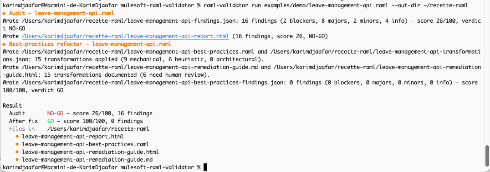
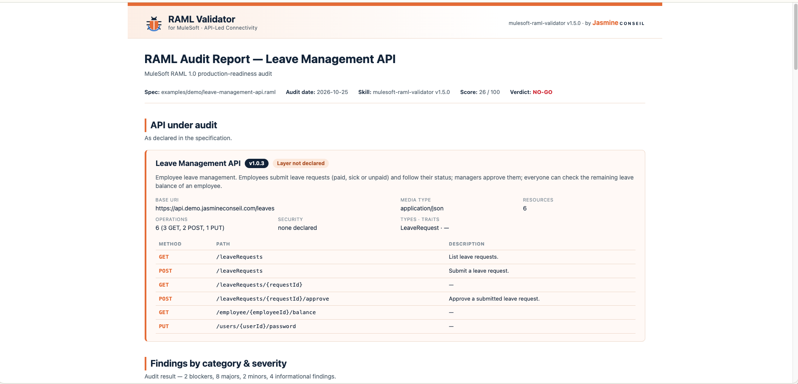
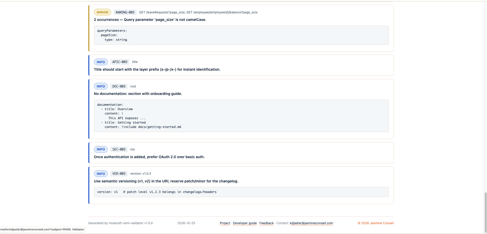
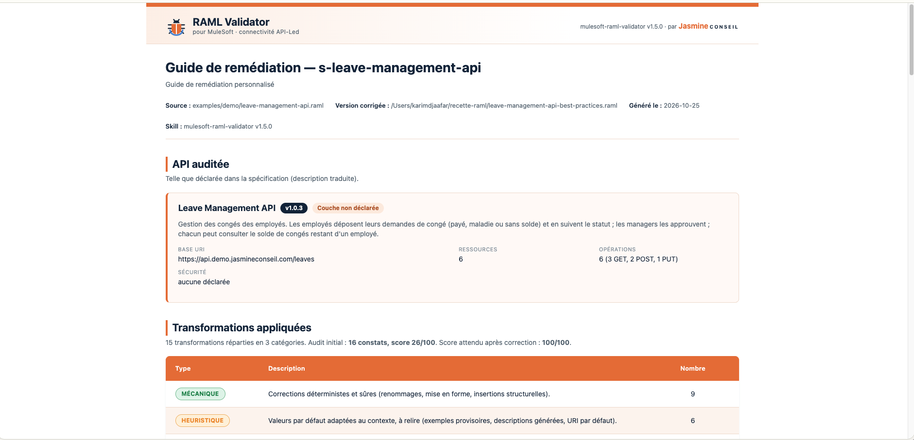
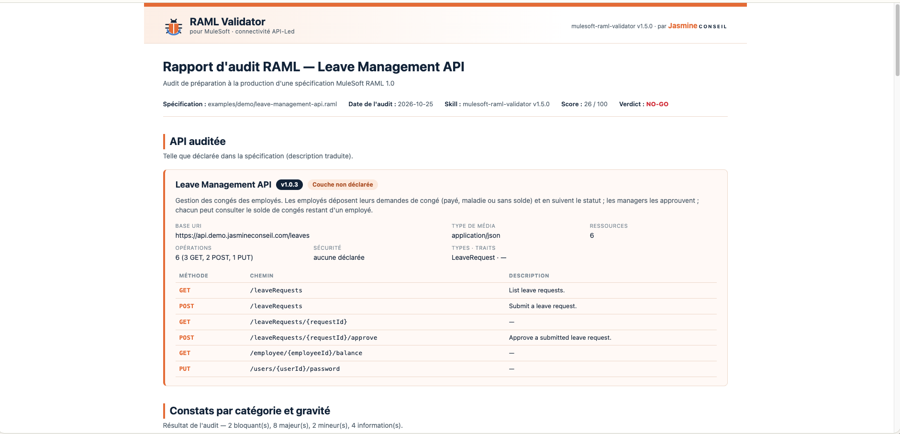
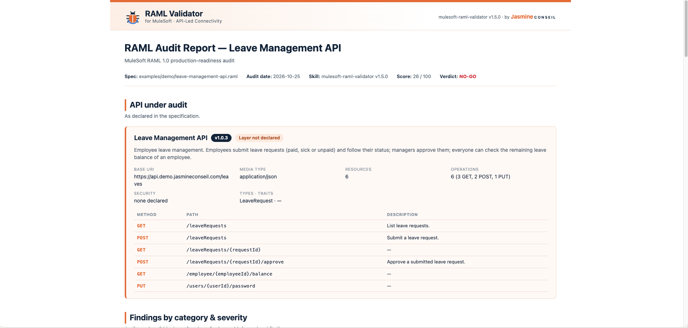

# Acceptance tests — mulesoft-raml-validator

| Document | Version | Date | Author | Status |
|---|---|---|---|---|
| Acceptance tests — mulesoft-raml-validator | 1.5.0 | 2026-10-25 | Karim DJAAFAR — Jasmine Conseil | Released |

The automated part of these tests runs on every push on Ubuntu, macOS and
Windows (`.github/workflows/acceptance.yml`). The manual run below is performed
**before every release**, on a real machine
(macOS or Linux), in a **new terminal**, from a clean state. Each step gives the
expected result; the release is accepted when all 8 steps match.

---

## 1. Clean start

```bash
cd /path/to/mulesoft-raml-validator/skills/mulesoft-raml-validator
rm -rf .venv
export PATH="$PWD/bin:$PATH"
autoload -Uz compinit && compinit
eval "$(raml-validator completion zsh)"
raml-validator --version
```

Expected: `mulesoft-raml-validator v1.5.0`. On bash, skip the `compinit` line
and use `completion bash`. On **Windows (PowerShell)**:

```powershell
cd C:\path\to\mulesoft-raml-validator\skills\mulesoft-raml-validator
Remove-Item -Recurse -Force .venv -ErrorAction SilentlyContinue
$env:Path = "$PWD\bin;$env:Path"
raml-validator completion powershell | Out-String | Invoke-Expression
raml-validator --version
```

The next steps are the same commands on every OS (`open` → `Start-Process`
on Windows; `| cat` → `| Out-String` for step 7; `echo $?` → `$LASTEXITCODE`).

## 2. Automatic installation of the dependencies

```bash
raml-validator verify
echo $?
ls -d .venv
raml-validator setup
```

Expected:
1. At the top of `verify`: "PyYAML and Jinja2 are missing … one-time setup",
   then "✔ Python environment ready".
2. Then the 7 steps and `VERDICT — v1.5.0 FULLY DEPLOYED`; `echo $?` prints `0`.
3. `.venv` exists, and `setup` answers "✔ Python environment ready" at once,
   without installing anything.

## 3. Tab completion

| Type, then press Tab | Expected |
|---|---|
| `raml-validator ` | audit, completion, fix, run, setup, verify, with their descriptions |
| `raml-validator run examples/demo/` | only the two `.raml` files: `leave-management-api.raml` and `leave-management-api-best-practices.raml` (no `.json`, no `.html`) |
| `raml-validator run x.raml --lang ` | `en` and `fr` |

## 4. Reference demo in English

```bash
raml-validator run examples/demo/leave-management-api.raml --out-dir ~/acceptance-raml
open ~/acceptance-raml/leave-management-api-report.html
```

Expected in the terminal: orange step titles; **NO-GO** in red, 26/100,
16 findings; **GO** in green, 100/100 after the fix; the list of files.
In the report: logo in the header band, "API under audit" with the API
description, the findings, a clickable contact address in the footer.
(`open` is macOS; use `xdg-open` on Linux.)

On **Linux (bash)**, step 1 uses `eval "$(raml-validator completion bash)"`
without the `compinit` line; on Debian / Ubuntu the `python3-venv` package must
be installed (prerequisite).

## 5. Reference demo in French

```bash
raml-validator run examples/demo/leave-management-api.raml --out-dir ~/acceptance-raml --lang fr --api-description "Gestion des congés des employés. Les employés déposent leurs demandes de congé (payé, maladie ou sans solde) et en suivent le statut ; les managers les approuvent ; chacun peut consulter le solde de congés restant d'un employé."
open ~/acceptance-raml/leave-management-api-report.fr.html
open ~/acceptance-raml/leave-management-api-remediation-guide.fr.html
```

Expected in both pages: everything in French, "API auditée" section, the
translated description followed by "(description traduite)", severities shown
as BLOQUANT / MAJEUR.

## 6. Clean specification

```bash
raml-validator audit examples/s-customer-orders-api.raml --out-dir ~/acceptance-raml
```

Expected: **GO** in green, 100/100, 0 findings.

## 7. Output without colours

```bash
raml-validator audit examples/s-customer-orders-api.raml --out-dir ~/acceptance-raml --no-color
raml-validator audit examples/s-customer-orders-api.raml --out-dir ~/acceptance-raml | cat
```

Expected: plain text, no colour codes, in both cases.

## 8. Error cases

```bash
raml-validator audit missing.raml
echo $?
raml-validator run examples/demo/
echo $?
raml-validator run examples/demo/leave-management-api.raml --lang de
```

Expected: `ERROR: file not found: missing.raml` then `3`;
`ERROR: not a file: examples/demo — give the path of a .raml file, e.g.
examples/demo/<name>.raml` then `3`; then a refusal
`invalid choice: 'de' (choose from 'en', 'fr')`.

---

## Record of runs

| Version | Date | Machine | Tester | Result |
|---|---|---|---|---|
| 1.5.0 | 2026-10-25 | Mac mini (macOS Tahoe, zsh) | Karim DJAAFAR | in progress |
| 1.5.0 | 2026-10-25 | Ubuntu 24.04.4 LTS (bash 5.2.21, Python 3.12.3) | Claude (clean container) | ✅ 8/8 |

### Run of 2026-10-25 — Mac mini (macOS Tahoe, zsh), v1.5.0

Results observed on the tester's machine, filled in as the run goes.

| Step | Result | Observed output |
|---|---|---|
| 1. Clean start | ✅ pass | `mulesoft-raml-validator v1.5.0` |
| 2. Automatic installation | ✅ pass | `.venv` created from scratch (after `rm -rf .venv`); `verify` → `VERDICT — v1.5.0 FULLY DEPLOYED`, 7/7 checks (31 files; broken fixture 17 findings / 21 NO-GO; clean fixture 0 / 100 GO; round-trip 100/100 GO; demo 16 findings / 26 → 100 GO), exit code `0`; `setup` then answers at once: `✔ Python environment ready: …/mulesoft-raml-validator/.venv`. |
| 3. Tab completion | ✅ pass — **finding fixed** | `--lang ` + Tab → `en  fr` ✅. Enter instead of Tab after `--lang` gives the expected argparse message `argument --lang: expected one argument` (no crash). Enter pressed instead of Tab on `raml-validator run examples/demo/`: the folder crashed `audit_raml.py` with a Python traceback (`IsADirectoryError`). **Fixed**: `ERROR: not a file: examples/demo — give the path of a .raml file`, exit `3`; case added to step 8 and to the CI. Tab on `raml-validator run examples/demo/leave-management-api` → `leave-management-api-best-practices.raml  leave-management-api.raml` (`.raml` only) ✅. Earlier:  `raml-validator ` + Tab → audit, completion, fix, run, setup, verify, each with its description ✅ |
| 4. Demo in English | ✅ pass — **finding fixed and re-checked** | Footer: Project · Developer guide · Feedback · Contact: kdjaafar@jasmineconseil.com (link `mailto:…?subject=RAML Validator`), © 2026 Jasmine Conseil ✅; detailed findings with severity pills and remediation snippets ✅.  Re-check after the fix: base URI `https://api.demo.jasmineconseil.com/leaves` on one line ✅.  Report (Safari/Chrome): logo and project name in the header band, "by Jasmine CONSEIL", v1.5.0, verdict NO-GO, "API under audit" with description, version pill, "Layer not declared", 6 operations ✅. Finding: the base URI wrapped in the middle of a word ("…/lea ves") — **fixed**, the base URI now spans two columns (report and guide, EN and FR). Colours checked on screen (Terminal.app): step titles orange, NO-GO red, GO green, file bullets orange, "Files in" dimmed.  Audit `NO-GO — score 26/100, 16 findings` (2 blockers, 8 majors, 2 minors, 4 info); refactor: 15 transformations (9 mechanical, 6 heuristic), 6 to review; after fix `GO — score 100/100, 0 findings`; 4 files listed in `~/recette-raml`. |
| 5. Demo in French | ✅ pass — **findings fixed** | French audit report: "Rapport d'audit RAML", "API auditée" with "(description traduite)", "Couche non déclarée", "Constats par catégorie et gravité", 2 bloquant(s), 8 majeur(s) ✅ (operation descriptions quoted from the spec stay in their original language).  Findings in the French guide (MD and HTML): 8 before / after summaries still in English ("6 resources without description", "placeholder examples added to 1 request bodies"…), and next steps pointing to `scripts/audit_raml.py`. **Fixed**: summaries translated ("6 ressources sans description", "exemples provisoires ajoutés à 1 corps de requête"…), guides point to `raml-validator audit`. Before the fix: Remediation guide: header "pour MuleSoft · connectivité API-Led", "par Jasmine CONSEIL"; "API auditée" with the French description and "(description traduite)"; "Couche non déclarée", "aucune déclarée"; "Transformations appliquées": 15, audit initial 16 constats / 26/100; MÉCANIQUE 9, HEURISTIQUE 6 ✅. |
| 6. Clean specification | ⏳ to run | |
| 7. No colours | ⏳ to run | |
| 8. Error cases | ⏳ to run | |

Screenshots of this run (`docs/images/acceptance/`):

| Step 4 — terminal colours | Step 4 — report |
|---|---|
|  |  |
| **Step 4 — report footer and contact** | **Step 5 — French remediation guide** |
|  |  |

| **Step 5 — French audit report** | |
|  | |

Finding of step 4, before the fix (base URI wrapped in the middle of a word):


### Run of 2026-10-25 — Ubuntu 24.04.4 LTS (bash 5.2.21, Python 3.12.3), v1.5.0

Run by Claude in a clean Ubuntu container, with the distribution's Python
(`RAML_VALIDATOR_PYTHON=/usr/bin/python3.12`, no PyYAML installed).

| Step | Result | Observed output |
|---|---|---|
| 1. Clean start | ✅ pass | `mulesoft-raml-validator v1.5.0` |
| 2. Automatic installation | ✅ pass | "PyYAML and Jinja2 are missing for /usr/bin/python3.12 — one-time setup." → "✔ Python environment ready"; `VERDICT — v1.5.0 FULLY DEPLOYED`, exit `0`; `.venv` with Python 3.12.3; `setup` answers at once. |
| 3. Tab completion | ✅ pass | commands `audit fix run verify setup completion --version --help`; in `examples/demo/`: the two `.raml` files only; `--lang` → `en fr` |
| 4. Demo in English | ✅ pass | NO-GO in red — 26/100, 16 findings; GO in green — 100/100 after fix |
| 5. Demo in French | ✅ pass | 4 French files written; "description traduite" present in the report and the guide |
| 6. Clean specification | ✅ pass | GO — score 100/100, 0 findings |
| 7. No colours | ✅ pass | 0 colour codes with `--no-color` (terminal) and when piped |
| 8. Error cases | ✅ pass | `ERROR: file not found: missing.raml`, exit `3`; `invalid choice: 'de' (choose from 'en', 'fr')` |

### Plugin validation — 2026-10-25

`claude plugin validate` (Claude Code 2.1.310) on the repository:
"These checks found nothing to report" — **✔ Validation passed**. Advice only:
add a marketplace install line to the README once the plugin is listed.

## Historique du document

| Version | Date | Commentaire |
|---|---|---|
| 1.5.0 | 2026-10-25 | First acceptance test procedure: clean start, automatic setup, completion, demo EN/FR, clean spec, no colour, error cases. |

Contact: Karim DJAAFAR — [kdjaafar@jasmineconseil.com](mailto:kdjaafar@jasmineconseil.com)

<p align="right"><span style="color:#E97132">© 2026 Jasmine Conseil</span></p>
